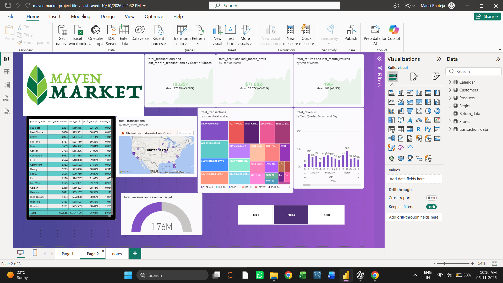

# Maven Market Sales Analysis 📊

## 📌 Project Overview
This project focuses on analyzing Maven Market sales data using Microsoft Power BI. The dashboard provides insights into sales performance, profit, returns, product brands, and store transactions.

## 🎯 Project Objectives
- Analyze overall sales and transaction performance.
- Track total revenue, profit, and returns.
- Compare actual performance with business targets.
- Identify high-performing product brands.
- Analyze transactions across different store locations.
- Understand revenue trends over time.

## 🛠️ Tools & Technologies
- Microsoft Power BI
- Power Query
- DAX
- Data Modeling
- Data Visualization

## 📈 Key Performance Indicators

| KPI | Dashboard Value |
|---|---:|
| Total Transactions | 18,325 |
| Total Profit | $71,682 |
| Total Returns | 496 |
| Total Revenue | $1.76M |

*Values shown are from the dashboard screenshot.*

## 📊 Dashboard Features
1. **Sales Performance:** Tracks transactions, revenue, and profit.
2. **Product Analysis:** Compares product brands using transactions, profit, profit margin, and return rate.
3. **Store Analysis:** Displays transactions by store address and location.
4. **Revenue Trends:** Analyzes revenue across different time periods.
5. **Target Analysis:** Compares actual performance against business goals.

## 🖼️ Dashboard Preview

## 💡 Skills Demonstrated
- Data Analysis
- Data Cleaning and Transformation
- DAX Calculations
- Data Modeling
- KPI Development
- Interactive Dashboard Design

## 📁 Project Files
- `maven market project file.pbix` – Power BI dashboard file.
- `Maven-Market-Dashboard.png.png` – Dashboard screenshot.

## 👩‍💻 Author
Mansi Bhateja

Aspiring Data Analyst | Python | SQL | Power BI | Excel
